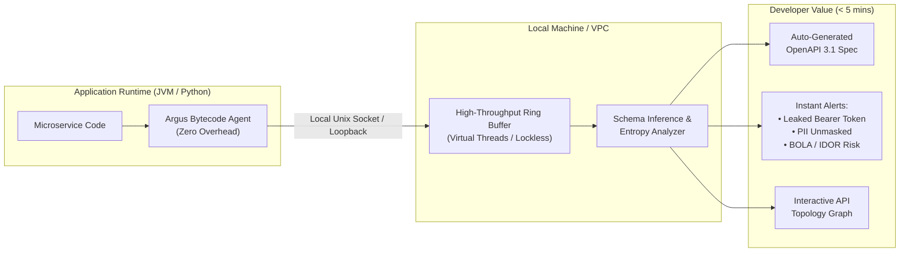
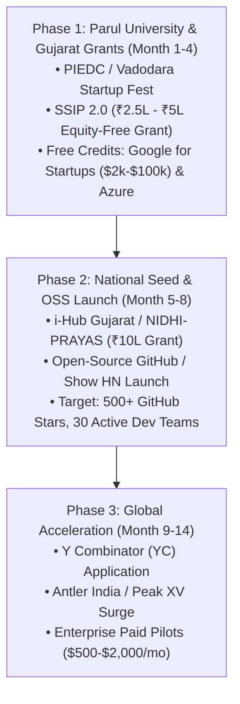

# Startup Masterplan: Argus
*The 100-Eyed Runtime Sentinel: Zero-Overhead, Local-First API & Agent Security*

---

## 1. Executive Summary

- **What It Is**: A developer-first, zero-overhead runtime agent that attaches to backend microservices to passively map living API contracts (OpenAPI 3.1), detect undocumented "shadow APIs", uncover broken object-level authorization (BOLA/IDOR), and flag cleartext secrets or PII leaks in real time.
- **Form Factor**: Non-intrusive Java bytecode agent (`-javaagent`) and Python ASGI middleware streaming asynchronously to a local, high-throughput collector daemon and interactive web dashboard.
- **Core Philosophy**: **100% Local-First & Zero AI-Slop**. No sensitive customer payloads ever leave the developer's infrastructure or VPC. Hardcore systems engineering and deterministic security rules replace unreliable LLM hallucinations.
- **Founding Team**: 
  - **Himanshu (CTO / Lead Systems Architect)**: Java Agent internals, high-concurrency collector, security rules engine.
  - **Vansh (Data Science & Visuals Lead)**: Python ASGI agent, PII/secret entropy algorithms, interactive node graph UI.
  - **Koustav (Growth & Developer Marketing)**: Developer documentation, user interviews, university demo days, outreach to engineering leads.

---

## 2. The Problem: Why Engineering Teams Are Bleeding



### The Three Industry Agonies:
1. **API Documentation is Perpetually Rotting**:
   Developers write code fast; Swagger/OpenAPI docs are outdated the moment they are merged. Staging breaks because nobody knows what the real request/response payloads look like.
2. **Shadow APIs & Secret Leaks**:
   Developers leave debug endpoints (e.g. `/api/v1/internal/dump`) active in production. APIs casually return full database rows containing unhashed tokens, phone numbers, or passwords.
3. **BOLA / IDOR (OWASP API Top 10 #1)**:
   Traditional WAFs (Cloudflare, AWS WAF) inspect HTTP headers and basic regexes, but they cannot tell if User A is accessing User B's `/orders/9821` payload. Because our agent sits inside the application runtime, it inspects the route template, the authenticated principal, and the object ID simultaneously.

---

## 3. Technical Architecture & Engineering Moat

### Component 1: The Java Bytecode Agent (`argus-java-agent`)
- Built using `ByteBuddy` and JVM `java.lang.instrument`.
- Attaches to Spring Boot / Netty / Tomcat request pipelines at class-load time.
- Hooks into `DispatcherServlet` / filter chains *after* TLS termination and *with* access to Spring `SecurityContext`.
- Captures: Route path pattern (e.g., `/api/v2/users/{id}`), HTTP method, status code, sanitized request/response payload schemas, and auth claims.
- **Concurrency & Overhead Guarantee**: Offloads telemetry using lock-free ring buffers (LMAX Disruptor style or Java 21 Virtual Threads) over a local loopback socket. Adds `< 0.3ms` latency to request processing.

### Component 2: The Python ASGI Agent (`argus-python`)
- Drop-in ASGI middleware for FastAPI, Starlette, and Django.
- Non-blocking stream interception using Python `asyncio`.
- Emits standardized Protobuf / JSON telemetry frames to the local collector daemon.

### Component 3: Local Collector & Analysis Engine (`argus-core`)
- High-throughput Go/Java daemon running inside Docker Compose or local machine.
- **Dynamic Schema Synthesizer**: Merges live requests into a clean, unified OpenAPI 3.1 JSON/YAML file.
- **Entropy & Regex Sentinel**: High-speed scanner detecting JWT tokens, AWS/Stripe keys, credit cards, Aadhaar/SSN numbers, and email leaks.
- **Contract Drift Alerting**: Compares live traffic against git-committed OpenAPI specs to flag breaking schema changes in staging/PRs.

---

## 4. Team Division of Labor & Equity Framework

> [!IMPORTANT]
> To protect the startup and satisfy future investors (including YC), all founders must sign an **IP Assignment Agreement** and a standard **4-Year Vesting Schedule with a 1-Year Cliff**.

| Member | Title | Primary Ownership | 90-Day Key Deliverable |
| :--- | :--- | :--- | :--- |
| **Himanshu** | Co-Founder & CTO | Java Agent, High-Throughput Collector, Concurrency, Core Security Rules | Working `-javaagent` capturing Spring Boot traffic with `< 1%` CPU overhead |
| **Vansh** | Co-Founder & Head of Product/Data | Python ASGI Agent, PII Detection Algorithms, Interactive React/Graph UI | FastAPI middleware + Clean local web dashboard at `localhost:4000` |
| **Koustav** | Co-Founder & Head of Growth | Documentation, Quickstart Guides, Cold Outreach, Pitch Decks, Demo Days | 25 recorded developer user interviews + Parul University grant pitch deck |

---

## 5. The Funding Ladder: From Vadodara to Global Stage



### 1. Local & Regional Grants (Immediate - Months 1 to 4):
- **Parul Innovation and Entrepreneurship Development Center (PIEDC)**: Pitch at college demo days and the annual Vadodara Startup Festival. Access university labs, co-working space, and initial prototyping support.
- **Gujarat SSIP 2.0 (Student Startup and Innovation Policy)**: Government of Gujarat provides up to ₹2.5 Lakhs to ₹5 Lakhs for student proof-of-concept and prototyping without giving up any equity.
- **i-Hub Gujarat**: State incubation center in Ahmedabad offering mentorship, IP filing assistance, and seed grants.

### 2. Cloud Credits & Dev Ecosystem Programs:
- **Google for Startups Cloud Program**: Apply with your student domain and pitch deck to receive \$2,000 to \$100,000 in Google Cloud credits.
- **Microsoft for Startups Founders Hub**: Immediate access to \$5,000 to \$25,000 in Azure credits, GitHub Enterprise, and OpenAI API access.

### 3. Global Tier-1 Acceleration (Months 9 to 14):
- **Y Combinator (YC)**: Applies directly with measurable metrics: 1,000+ GitHub stars, 50+ weekly active engineering teams running the agent, and 2-3 enterprise letters of intent (LOIs).
- **Alternative Top Accelerators**: Antler India, Peak XV Surge, Entrepreneur First (EF), Techstars.

---

## 6. 12-Month Execution Roadmap

````carousel
```markdown
### Quarter 1 (Months 1–3): The Core Engine Alpha
- [ ] Build `argus-java-agent` core: intercept Spring Boot requests, extract route templates and headers.
- [ ] Build `argus-python` ASGI middleware for FastAPI.
- [ ] Implement asynchronous ring-buffer collector and basic PII/secret regex scanner.
- [ ] Pitch at Parul University PIEDC / Vadodara Startup Fest; apply for Gujarat SSIP 2.0 grant.
- [ ] Target: Single `docker-compose.yml` demo running in under 2 minutes.
```
<!-- slide -->
```markdown
### Quarter 2 (Months 4–6): Open-Source Public Launch
- [ ] Package as an Apache-2.0 open-source project with world-class documentation.
- [ ] Ship local dashboard: Interactive API topology map + one-click `openapi.json` export.
- [ ] Launch on Show HN, Reddit (`/r/java`, `/r/Python`, `/r/devops`), and Product Hunt.
- [ ] Secure Google for Startups Cloud credits ($25k-$100k tier).
- [ ] Target: 500+ GitHub Stars, 20 active development teams testing in local environments.
```
<!-- slide -->
```markdown
### Quarter 3 (Months 7–9): CI/CD Gating & Early Enterprise Pilots
- [ ] Add CI/CD GitHub Action: Fail pull requests if an endpoint leaks PII or breaks API schemas.
- [ ] Implement BOLA/IDOR heuristic detection rules based on runtime auth contexts.
- [ ] Koustav conducts structured cold outreach to 100 tech leads at fast-growing Indian and global SaaS startups.
- [ ] Close 3-5 friendly design partner startups using the tool in their staging/test environments.
```
<!-- slide -->
```markdown
### Quarter 4 (Months 10–12): YC Application & Commercialization
- [ ] Launch Hosted Team Dashboard (Open-Core commercial tier for team collaboration & compliance logs).
- [ ] Record 2-minute demo video showing 5-minute setup and immediate high-severity secret catch.
- [ ] Secure 2 paid pilot contracts or letters of intent (LOIs).
- [ ] Submit Y Combinator application with clear weekly active user (WAU) growth and technical moat.
```
````

---

## 7. The Unfair Advantages & Pitch Narrative

When pitching to Parul University judges, Gujarat SSIP grant evaluators, or YC partners, this is the winning story:

1. **Founders with Deep Technical Authenticity**:
   You aren't business majors packaging an OpenAI API wrapper. You are hardcore systems engineers building low-level JVM bytecode and asynchronous network instrumentation.
2. **Timing & Market Tailwinds**:
   With microservices and AI-generated code exploding, APIs are being deployed 10x faster than humans can document or audit them. API breaches (BOLA/IDOR) have become the #1 threat vector in modern enterprise breaches.
3. **Frictionless Adoption**:
   Zero code changes, local-first privacy (no compliance headaches), and value generated in under 5 minutes.
