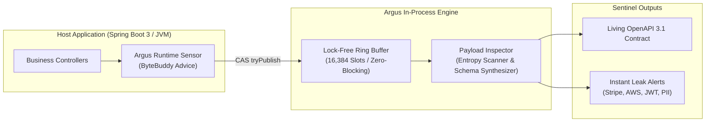

# Argus

**In-process runtime security and living contract sentinel for microservices and AI agent tool calls.**

[](https://openjdk.org/)
[](https://spring.io/)
[](https://python.org/)
[](LICENSE)

---

## Overview

Argus is an in-process, sub-millisecond security and contract sentinel for distributed microservices and autonomous AI agent tool calls.

Unlike external network proxies or eBPF sniffers, Argus attaches directly inside the application runtime (`-javaagent` / ASGI middleware). It inspects HTTP transactions **after** TLS termination, resolving true framework **Route Templates** (e.g. `/orders/{id}`) with zero false positives, detecting live **Secret and PII leaks**, and tracking schema drift without adding perceptible latency.



---

## Core Invariants

1. **In-Process Precision**: Captures exact framework route templates and security contexts (`SecurityContextHolder`) without guessing path variables.
2. **Zero-Blocking Performance**: If telemetry buffers saturate under extreme traffic surges, events are dropped via atomic counters; user request threads are **never blocked or delayed** (`< 0.3ms` p99 latency).
3. **100% Local-First Privacy**: Sensitive customer payloads and credentials never leave the host machine or customer VPC.
4. **Zero Dependency Conflicts**: Shaded agent namespace (`io.argus.agent.shadow.*`).

---

## Quickstart

### 1. Build from Source
```bash
git clone https://github.com/HimanshuJha-2005/argus.git
cd argus
mvn clean package -DskipTests
```

### 2. Launch with the Argus Sensor Attached
```bash
java -javaagent:argus-agent/target/argus-agent-0.1.0-SNAPSHOT.jar \
     -jar argus-sample/target/argus-sample-0.1.0-SNAPSHOT.jar
```

Standard boot output confirms the sensor attachment:
```text
[Argus] Runtime sensor initialized with capacity 16384
Tomcat started on port 8080 (http)
```

### 3. Exercise Endpoints

> **Note for Windows PowerShell**: Run `curl.exe` instead of `curl` (which aliases to `Invoke-WebRequest`).

```bash
# 1. Parameterized Route Template Resolution
curl http://localhost:8080/api/v1/orders/ord_998124

# 2. Live Secret Leak Detection (Catches unmasked Stripe key)
curl http://localhost:8080/api/v1/internal/dump

# 3. POST Schema Inference
curl -X POST http://localhost:8080/api/v1/users/usr_456 \
     -H "Content-Type: application/json" \
     -d '{"name":"Alice","role":"LEAD"}'
```

---

## Repository Structure

```text
argus/
├── GLOSSARY.md                # Ubiquitous domain language (Canonical reference)
├── AGENTS.md                  # Alignment rules for AI coding assistants
├── MASTERPLAN.md              # 12-Month roadmap, funding ladder, and startup model
├── docs/
│   ├── adr/
│   │   └── 0001-in-process-bytecode-instrumentation.md
│   └── spec/
│       └── 0001-java-runtime-sensor.md
├── argus-core/                # Pure Java 21 engine: Ring buffer & PayloadInspector
├── argus-agent/               # ByteBuddy in-process agent for DispatcherServlet
├── argus-sample/              # Spring Boot 3 verification application
├── argus-python/              # (In Progress) FastAPI / ASGI middleware sensor
└── argus-ui/                  # (Planned) Interactive API topology dashboard
```

---

## Founding Team
* **Himanshu Jha** ([@HimanshuJha-2005](https://github.com/HimanshuJha-2005)): Co-Founder & CTO (Systems Architecture, `argus-agent`, `argus-core`)
* **Vansh**: Co-Founder & Head of Product/Data (`argus-python`, PII Entropy Engine, `argus-ui`)
* **Koustav**: Co-Founder & Head of Growth (Documentation, Grants, Developer Relations)

---

## Contributing & Agent Guidelines
All contributors and AI coding assistants must strictly adhere to [AGENTS.md](./AGENTS.md) and [GLOSSARY.md](./GLOSSARY.md). No pass-through boilerplate, no fake abstraction layers. Deep modules only.
